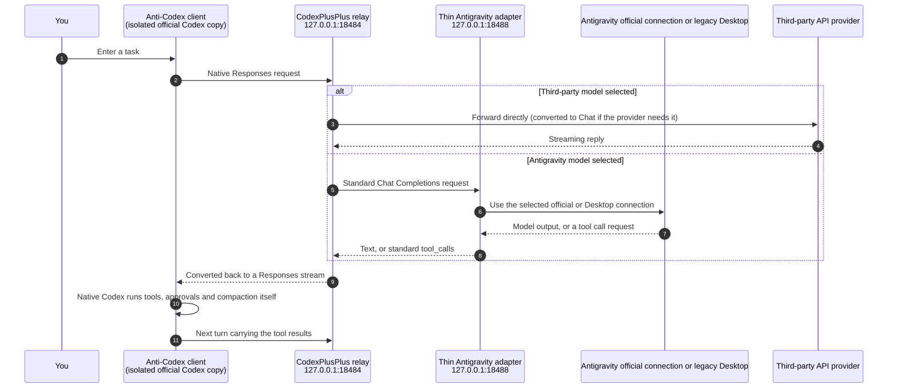

# Anti-Codex

<div align="center">


### Guarded, Isolated Official Codex Desktop Copy for Windows

[](#4-requirements--prerequisites)
[](#2-core-architecture-locked-3-layer-design)
[](#2-core-architecture-locked-3-layer-design)
[](#using-antigravity-models)
[](#license--disclaimer)

**[简体中文说明 (README.md)](README.md)** · **English Documentation** · **[3-Layer Architecture](docs/THREE_LAYER_ARCHITECTURE.md)** · **[Windows Guide](docs/WINDOWS.md)**

</div>

---

**Anti-Codex** is a guarded, `isolated` copy of the `official Codex` Desktop application for Windows. It preserves **100% of the native `Codex` UI, workflow, and underlying agent harness (`Codex` exclusively owns planning, `tools`, terminal commands, file edits, approvals, retries, and `compaction`)** while replacing only the model provider layer — letting you connect directly to third-party APIs or reuse your local **Antigravity Desktop** models and quota without touching a single file or login token of your original Codex installation.

> [!IMPORTANT]
> ### Using Antigravity models
> Pick **Antigravity 官方** in the normal chat input to use Google’s editor connection with your signed-in Antigravity CLI (`agy`). The legacy Desktop Cascade models use the running, signed-in Antigravity Desktop app.
> - **When using ordinary third-party APIs (not required)**: Ordinary `third-party` traffic is routed directly by `CodexPlusPlus` to your configured provider endpoint and `bypasses` `Antigravity` completely. You do not need Antigravity open (or even installed) for standard API keys.

---

## 1. Visual Overview: Official Codex vs. Anti-Codex

<div align="center">
<table>
  <thead>
    <tr>
      <th align="center" width="240">Official Codex Desktop</th>
      <th align="center" width="240">Anti-Codex Isolated Copy</th>
      <th align="left">Side-by-Side Isolation Highlights</th>
    </tr>
  </thead>
  <tbody>
    <tr>
      <td align="center">
        <br/>
        <sub><b>Original Blue Icon</b> · <code>ChatGPT.exe</code></sub>
      </td>
      <td align="center">
        <br/>
        <sub><b>Distinct Pink Icon</b> · <code>Anti-Codex.exe</code></sub>
      </td>
      <td>
        <ul>
          <li><b>True Side-by-Side Coexistence</b>: Separate executable, pink taskbar/tray identity, and isolated Electron user-data paths.</li>
          <li><b>Zero Mutation to Original</b>: Never alters official WindowsApps files or <code>%USERPROFILE%\.codex</code> sessions/auth.</li>
          <li><b>100% Native Experience</b>: Keeps native diffs, terminal tool loop, approvals, compaction, and multimodal vision.</li>
        </ul>
      </td>
    </tr>
  </tbody>
</table>
</div>

### Why Anti-Codex?

| Goal | How Anti-Codex Solves It |
| :--- | :--- |
| **Protect your official Codex setup** | Copies the host into `%LOCALAPPDATA%\Anti-Codex` and stores all runtime state inside `%APPDATA%\anticodex`. |
| **Keep the real Codex agent harness** | No custom task loop; native `Codex` owns planning, `tools`, shell execution, approvals, retries, and `compaction`. |
| **Use your Antigravity account** | Choose an **Antigravity 官方** model from the regular composer. Codex handles file operations and approvals in the same conversation. |
| **Connect any standard 3rd-party API** | Built-in `管理` (Manage) panel lets you test and switch to Responses or Chat Completions APIs directly. |
| **Safe updates & instant rollback** | Candidate host builds are patched, re-hashed, and gate-verified before atomic activation, keeping the prior version ready for 1-click rollback. |

---

## 2. Core Architecture (Locked 3-Layer Design)

<div align="center">
  
</div>

Anti-Codex is governed by a strict **[Three-Layer Architecture](docs/THREE_LAYER_ARCHITECTURE.md)** (see also **[Adaptive Provider Stack](docs/ADAPTIVE_ONE_API_STACK.md)**) and never introduces a fourth task-control layer:

1. **Layer 1 — Isolated Official Codex Shell**
   - Guarded copy of the installed official Codex Desktop app with minimal isolation patches (separate `Anti-Codex.exe`, AppUserModelId, pink icons, isolated state paths, and the in-app `管理` entry).
   - Native `Codex` owns planning, `tools`, command execution, approvals, retries, `compaction`, and completion decisions.
2. **Layer 2 — CodexPlusPlus General Provider Layer**
   - Upstream `CodexPlusPlus` (pinned release + audited isolation patches) handles general Responses/Chat conversion and ordinary third-party API connections.
   - **Direct Third-Party Bypass**: Ordinary `third-party` traffic connects directly to external providers and `bypasses` `Antigravity` completely.
3. **Layer 3 — Thin Antigravity Adapter**
   - The official route uses the signed-in `agy` client. The legacy route uses a thin Chat-to-Cascade adapter for the running Desktop app. Both return tool requests to Codex.

> [!NOTE]
> **Security & Authorization Boundary**: Original Codex files and user data remain untouched. `Connector-backed app tools` remain unavailable until genuinely authorized; copied local metadata never fakes or grants authorization.

---

## 3. How It Works

The selected model determines where the local relay sends each request. Codex retains control of tools and permissions.

### The full path of one request



### What each step does

| Step | Details |
| :--- | :--- |
| **1. Build an isolated client** | The installer copies the official Codex app from WindowsApps into `%LOCALAPPDATA%\Anti-Codex\codex-patched-app` (the original stays read-only). It renames `ChatGPT.exe` to `Anti-Codex.exe`, swaps in the pink icons, applies a few minimal patches to `app.asar` (branding, the `管理` entry, etc.), and recomputes the ASAR integrity hashes so Electron loads it normally. |
| **2. Separate all data** | The copy launches with its own Codex home (`%APPDATA%\anticodex`) and its own Electron user-data directory, so sign-in state, chat history and config never mix with the original app. |
| **3. Point the model endpoint at the local relay** | The isolated client's model endpoint is `http://127.0.0.1:18484/v1`, served by `CodexPlusPlus`. The client still sends its native request format and notices no difference. |
| **4. Route by model** | `CodexPlusPlus` checks which model you picked. Third-party models go straight to the API you configured in `管理` (ordinary third-party traffic bypasses Antigravity). Antigravity models are converted to standard Chat Completions and handed to the thin adapter on port `18488`. Route mismatches fail closed instead of silently switching models. |
| **5. Connect to Antigravity** | Official models use the signed-in `agy acp` client. The legacy thin adapter uses the local Desktop Cascade service. |
| **6. Tools stay with native Codex** | Codex handles file access, commands, and approvals. The official connection stays open until the tool result arrives and the same conversation can continue. |
| **7. Follow official updates** | After official Codex updates, sync rebuilds and validates a fresh copy in `update-candidate`, swaps it in only when every check passes, and keeps the previous version in `rollback-host`. |

### When to keep Antigravity Desktop open

Keep Desktop signed in and running when using the legacy route or refreshing its live catalog. The official route was tested with a signed-in CLI and Desktop running.

---

## 4. Requirements & Prerequisites

| Category | Requirement |
| :--- | :--- |
| **OS & Base Client** | Windows 10 / 11 (x64) with the official **Codex Desktop** installed (Microsoft Store / WindowsApps). |
| **Runtime** | **Node.js** (`node.exe` available on `PATH`) and Windows PowerShell 5.1. |
| **Route A: Third-party API** | Provider URL and API key. Anti-Codex discovers the advertised models and adds them to the composer menu. |
| **Route B: Antigravity** | A signed-in Antigravity CLI for models labeled **Antigravity 官方**. Legacy Desktop models require a running, signed-in Desktop app. |

---

## 5. Installation & Step-by-Step Usage

### Step 1: First-Time Installation

From the root of this repository, double-click:

```text
install-windows.bat
```

<details>
<summary>Or install from PowerShell (click to expand)</summary>

```powershell
powershell -ExecutionPolicy Bypass -File .\scripts\install-anticodex.ps1
```

The installer builds and validates the isolated host copy, deploys the verified `CodexPlusPlus` component, and creates the pink **Anti-Codex** Desktop shortcut and Start Menu folder.

</details>

### Step 2: Launch Anti-Codex (Check Prerequisites First!)

1. For official Antigravity models, sign in with the Antigravity CLI. For legacy Desktop models, keep Antigravity Desktop running and signed in.
2. Open **Anti-Codex** from your Desktop shortcut or `Start Menu > Anti-Codex > Anti-Codex`.
   - Launching the shortcut again while Anti-Codex is already open cleanly focuses the existing window instead of spawning duplicate instances.

### Step 3: Select Models, Vision Input & Third-Party APIs

- **Open Manager**: Click `管理` (Manage) in the bottom-left profile menu inside Anti-Codex, or open `Start Menu > Anti-Codex > Manage Anti-Codex`.
- **Antigravity models** — Choose the desired model and reasoning effort from the chat input. Official entries begin with **Antigravity 官方**.
- **Third-party APIs** — In `管理`, select the protocol, enter the provider URL and key, then save. Choose any discovered model from the chat input. Third-party chats and their automatic titles stay off the Antigravity connection.
- If the selected provider is unavailable, the chat reports the error and keeps your selected route.

<div align="center">
  <br/>
  <sub>Built-in multimodal vision verification asset (<code>assets/vision-smoke.png</code>) — native image attachment and visual inspection work out of the box</sub>
</div>

### Step 4: Sync After Official Codex Updates

Whenever official Codex Desktop updates via Microsoft Store, run:

```text
Start Menu > Anti-Codex > Sync Anti-Codex with Codex
```

Sync stages a candidate build, applies all shell/icon patches and ASAR integrity hashes, and replaces the active host only if every validation gate passes.

### Step 5: One-Click Rollback

To revert to the previous validated host version at any time, run:

```text
Start Menu > Anti-Codex > Rollback Anti-Codex
```

---

## 6. Quick Troubleshooting (FAQ)

1. **Why did model refresh or chat fail when using an Antigravity model?**
   - For an official model, check the Antigravity CLI login and the model menu. For a legacy Desktop model, check that Desktop is open and signed in, then refresh the catalog in `管理`.
2. **Can I run original blue Codex and pink Anti-Codex at the same time?**
   - Yes. Their binaries, local ports, Electron user-data directories, and state roots are completely isolated.
3. **Do I need Antigravity running when using my own third-party API key?**
   - No. Ordinary third-party APIs are routed directly by `CodexPlusPlus` and bypass Antigravity.

---

## 7. Developer Commands & Documentation Map

<details>
<summary><b>Diagnostic & Verification Commands (click to expand)</b></summary>

```powershell
# 1. Read-only check for official Codex updates and host drift
powershell -NoProfile -ExecutionPolicy Bypass -File .\scripts\check-anticodex-update.ps1 -NoPersist

# 2. Repair desktop/Start Menu shortcuts and isolated scheduled tasks
powershell -NoProfile -ExecutionPolicy Bypass -File .\scripts\repair-anticodex-shortcuts.ps1

# 3. Fast no-traffic installed health & UI verification (zero token cost)
powershell -NoProfile -ExecutionPolicy Bypass -File .\scripts\test-anticodex-installed-overall.ps1 -EnsureRunning -NoTraffic -Fast

# 4. Full source preflight & unit test suite (concurrency capped at 2)
powershell -NoProfile -ExecutionPolicy Bypass -File .\scripts\test-anticodex-source-preflight.ps1
node --test --test-concurrency=2 translator/tests/*.test.mjs
```

</details>

### Isolated Local Directories (Untouched `%USERPROFILE%\.codex`)

| Purpose | Path |
| :--- | :--- |
| **Install & Patched Host Root** | `%LOCALAPPDATA%\Anti-Codex` |
| **Isolated Config & State** | `%APPDATA%\anticodex` |
| **Health & Verification Reports** | `%APPDATA%\anticodex\reports` |

### Key Repository Documents

- **Chinese README**: [README.md](README.md)
- **Windows Setup & Runtime Guide**: [docs/WINDOWS.md](docs/WINDOWS.md)
- **Three-Layer Architecture**: [docs/THREE_LAYER_ARCHITECTURE.md](docs/THREE_LAYER_ARCHITECTURE.md)
- **Adaptive Provider Stack**: [docs/ADAPTIVE_ONE_API_STACK.md](docs/ADAPTIVE_ONE_API_STACK.md)
- **1.0 Completion Checklist**: [COMPLETION_CHECKLIST.md](COMPLETION_CHECKLIST.md)
- **Upstream Maintenance Guide**: [MAINTENANCE.md](MAINTENANCE.md)
- **Known Limitations**: [KNOWN_LIMITATIONS.md](KNOWN_LIMITATIONS.md)
- **Legacy Removal Manifest**: [docs/LEGACY_REMOVAL_MANIFEST.md](docs/LEGACY_REMOVAL_MANIFEST.md)
- **License & Third-Party Notices**: [LICENSE](LICENSE) · [THIRD_PARTY_NOTICES.md](THIRD_PARTY_NOTICES.md)

---

## License & Disclaimer

- **Project code**: [Non-commercial license](LICENSE). Personal, educational and research use, modification and sharing are allowed. Commercial use is not.
- **CodexPlusPlus component**: From upstream [BigPizzaV3/CodexPlusPlus](https://github.com/BigPizzaV3/CodexPlusPlus) under its AGPL-3.0 license. Patches live separately in `third_party/codexplusplus`.
- **Other third-party code**: See [THIRD_PARTY_NOTICES.md](THIRD_PARTY_NOTICES.md).
- This is a personal tool with no affiliation to OpenAI or Antigravity. Official models use the Antigravity editor connection. The legacy models use the Desktop interface, which can change on update. Follow each service’s terms of use.
